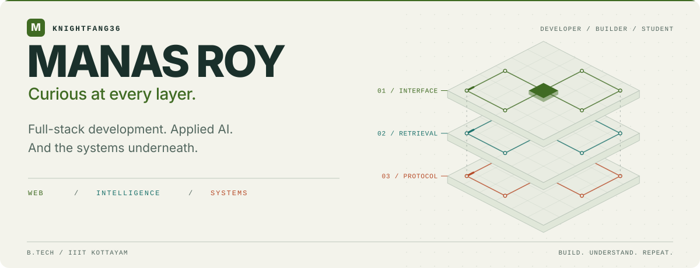
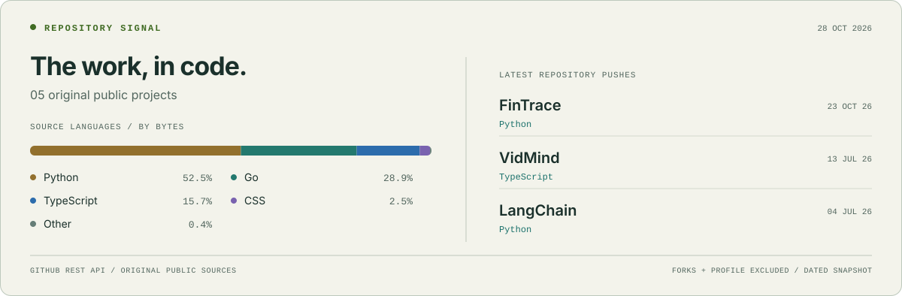

<picture>
  <source media="(max-width: 600px) and (prefers-color-scheme: dark)" srcset="assets/hero-mobile-dark.svg" />
  <source media="(max-width: 600px)" srcset="assets/hero-mobile-light.svg" />
  <source media="(prefers-color-scheme: dark)" srcset="assets/hero-dark.svg" />
  
</picture>

  <a href="#selected-work">Selected work</a> &nbsp; / &nbsp;
  <a href="#toolbox">Toolbox</a> &nbsp; / &nbsp;
  <a href="#repository-signal">Repository signal</a> &nbsp; / &nbsp;
  <a href="mailto:manroy2028@gmail.com">Get in touch ↗</a>

I'm **Manas**, a B.Tech student at **IIIT Kottayam**. I build across the stack: web interfaces, retrieval pipelines, transaction graphs, and network protocols. I'm also exploring **AI/ML and cybersecurity**.

I like projects that give me a reason to understand what happens underneath the API.

 

## Selected work

Different problems. Different layers of the stack.

### 01 / [FinTrace ↗](https://github.com/KnightFang36/FinTrace)

**Transaction investigation, with an evidence trail.** An explainable workspace for synthetic financial transactions: explicit rules, chronological transaction graphs, versioned cases, and evidence exports.

`Python` · `DuckDB` · `NetworkX` · `Streamlit` &nbsp; / &nbsp; [Architecture](https://github.com/KnightFang36/FinTrace#system-architecture) · [Source](https://github.com/KnightFang36/FinTrace)

### 02 / [VidMind ↗](https://github.com/KnightFang36/VidMind)

**Ask the video. Follow the source.** A browser extension for chatting with YouTube videos. Hybrid semantic + keyword retrieval, cross-encoder reranking, and streamed answers with timestamped citations. *In development.*

`TypeScript` · `React` · `FastAPI` · `LangChain` &nbsp; / &nbsp; [Retrieval pipeline](https://github.com/KnightFang36/VidMind#rag-pipeline) · [Source](https://github.com/KnightFang36/VidMind)

### 03 / [Stratum ↗](https://github.com/KnightFang36/Stratum)

**Below the download button.** A concurrent BitTorrent client built from scratch in Go: peer-wire protocol, Kademlia DHT discovery, piece verification, and persistent download resumption. Supports torrent files and magnet links.

`Go` · `BitTorrent` · `DHT` · `Concurrency` &nbsp; / &nbsp; [How it works](https://github.com/KnightFang36/Stratum#what-is-it) · [Source](https://github.com/KnightFang36/Stratum)

  
Also in the workshop

- [LangChain](https://github.com/KnightFang36/LangChain) — components and experiments for retrieval applications.
- [Music Manager](https://github.com/KnightFang36/Music-Manager) — a DSA project.
- [Browse all repositories ↗](https://github.com/KnightFang36?tab=repositories)

 

## Toolbox

The tools behind those projects, grouped by what they help me build.

| Layer | Tools |
| :--- | :--- |
| **Interfaces** | TypeScript · React · Next.js · Tailwind CSS |
| **Services & systems** | Python · FastAPI · Go · Linux · Git · Docker |
| **Retrieval & AI** | LangChain · FAISS · BM25 · Hugging Face |
| **Data & investigation** | DuckDB · Parquet · Pandas · NetworkX · Streamlit |

 

## Repository signal

A dated snapshot of my original public projects: source-language composition and recent repository pushes.

<a href="https://github.com/KnightFang36?tab=repositories">
  <picture>
    <source media="(max-width: 600px) and (prefers-color-scheme: dark)" srcset="assets/signal-mobile-dark.svg" />
    <source media="(max-width: 600px)" srcset="assets/signal-mobile-light.svg" />
    <source media="(prefers-color-scheme: dark)" srcset="assets/signal-dark.svg" />
    
  </picture>
</a>

Scheduled to refresh daily with GitHub Actions. Language share measures source bytes, not proficiency. [Data and build details](docs/profile.md).

 

---

  <b>Have an interesting problem to work on?</b>  
  <a href="mailto:manroy2028@gmail.com">Email</a> &nbsp; / &nbsp;
  <a href="https://www.linkedin.com/in/manasroy01/">LinkedIn</a> &nbsp; / &nbsp;
  <a href="https://leetcode.com/manasroy/">LeetCode</a>

Build something. Follow the questions deeper.

